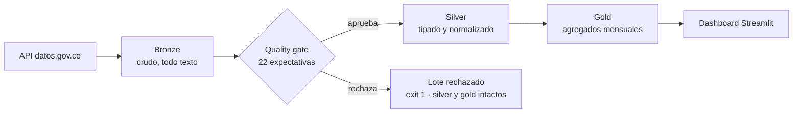
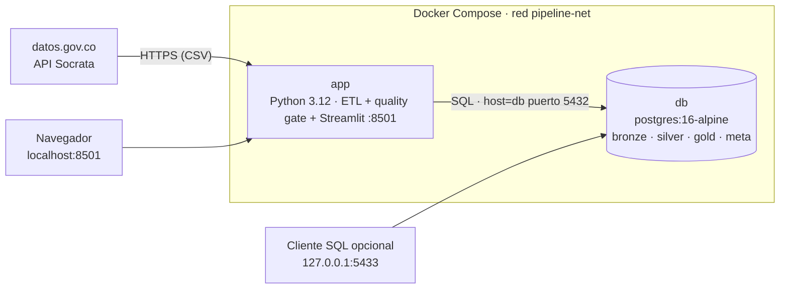

# Eje Cafetero Quality Gate

Pipeline de datos de punta a punta (extracción, validación, carga y dashboard) sobre precios
mayoristas de alimentos del Eje Cafetero, que demuestra **cómo un dato corrupto daña las
decisiones si no pasa pruebas de calidad**.

Corre en **dos contenedores** comunicados por una red de Docker Compose: `app` (código propio) y
`db` (PostgreSQL oficial).

## Qué hace

Cada lote de datos pasa por capas (arquitectura medallion). Una compuerta de calidad decide si el
lote puede avanzar: si no pasa, **silver y gold conservan el último lote aprobado** y el dashboard
nunca ve el dato dañado.



| Capa | Qué contiene |
|---|---|
| `bronze` | Dato crudo tal como llega (todo texto) más metadatos del lote. |
| `silver` | Precios y fechas tipados, solo de lotes que pasaron el gate. |
| `gold` | Precio promedio mensual y variación contra el mes anterior. |
| `meta` | Auditoría: cada ejecución del gate, con las reglas que fallaron. |

**Datos:** *Historico de Precios Productos de la Canasta Familiar, RAP Eje Cafetero*
([datos.gov.co](https://www.datos.gov.co/resource/gdqq-rry2), id `gdqq-rry2`): 83.813 filas, 2022 a
2025, 4 ciudades, 213 productos.

## Arquitectura: dos contenedores comunicados



Versión en imagen: [`docs/images/architecture.png`](docs/images/architecture.png).

| Contenedor | Imagen | Qué hace |
|---|---|---|
| `app` | Dockerfile propio (`python:3.12-slim`) | Extrae, valida con Great Expectations, carga bronze/silver/gold y sirve el dashboard en el puerto 8501. |
| `db` | `postgres:16-alpine` (oficial) | Guarda las cuatro capas. Tiene *healthcheck*, y `app` espera a que esté sano. |

`app` encuentra a `db` **por el nombre del servicio** (`host=db`, puerto 5432), no por una IP fija.
Los dos puertos publicados escuchan solo en `127.0.0.1`.

## Requisitos

- Docker Desktop con Docker Compose v2 (probado con Docker 29.8.2 y Compose 5.6.0).
- Git.
- Puertos **8501** y **5433** libres en tu máquina.
- Internet solo para `--source live`. Con `--source fixture` todo funciona sin conexión.

## Puesta en marcha

```bash
git clone https://github.com/JsMorales0301/eje-cafetero-quality-gate.git
cd eje-cafetero-quality-gate
```

**1. Crear tus credenciales.** El archivo `.env` no se sube al repositorio. Cópialo y cambia la
contraseña:

```bash
cp .env.example .env
```

**2. Construir la imagen y levantar la base de datos:**

```bash
docker compose build app
docker compose up -d db
```

**3. Verificar que `db` esté sana** (debe decir `healthy`):

```bash
docker compose ps
```

## Operación de ejemplo: guardar un dato y consultarlo

La operación usa la muestra local de 30 filas (`--source fixture`), así que el resultado es
**siempre el mismo**.

**Guardar** (recorre todas las capas):

```bash
docker compose run --rm app python -m pipeline.run --source fixture
```

Resultado esperado (el identificador del lote cambia, lo demás no):

```text
STAGE extract     OK     source=fixture rows=30
STAGE bronze      OK     batch=<id-del-lote> rows=30
STAGE quality_gate OK     expectations=22 silver_rows=30
STAGE gold        OK     precio_mensual=24
RESULT OK bronze=30 silver=30 gold=24
```

**Consultar** los dos contenedores trabajando juntos (`app` escribió, `db` responde):

```bash
docker compose exec db psql -U pipeline -d canasta -c "SELECT producto, ciudad, mes, precio_promedio, observaciones FROM gold.precio_mensual WHERE producto = 'Patilla';"
```

Resultado esperado:

```text
 producto | ciudad  |    mes     | precio_promedio | observaciones
----------+---------+------------+-----------------+---------------
 Patilla  | Pereira | 2024-03-01 |         2090.00 |             1
```

Y el conteo por capa:

```bash
docker compose exec db psql -U pipeline -d canasta -c "SELECT 'bronze' AS capa, count(*) FROM bronze.precios_raw UNION ALL SELECT 'silver', count(*) FROM silver.precios UNION ALL SELECT 'gold mensual', count(*) FROM gold.precio_mensual;"
```

Esperado: `bronze 30`, `silver 30`, `gold mensual 24`.

## Demostración: un dato corrupto no llega al dashboard

Inyecta duplicados en el lote y comprueba que el gate lo detiene (código de salida **1**):

```bash
docker compose run --rm app python -m pipeline.run --source fixture --corrupt duplicates
echo "exit=$?"
```

Resultado esperado:

```text
STAGE extract     OK     source=fixture rows=30
STAGE corrupt     OK     kinds=duplicates seed=42 rows=31
STAGE bronze      OK     batch=<id-del-lote> rows=31
STAGE quality_gate FAILED failed=1/22 expectations; silver and gold keep the last approved data
  - key_unique unexpected=2 observed=None
RESULT FAILED stage=quality_gate exit=1
exit=1
```

Silver sigue con las 30 filas aprobadas. Códigos de salida de `pipeline.run`:

| Código | Significado |
|---|---|
| `0` | Todas las etapas terminaron bien. |
| `1` | El quality gate rechazó el lote. |
| `2` | Otro fallo (se imprime la etapa: `config`, `extract`, `corrupt`, `bronze`, `gold`). |

Tipos de corrupción disponibles en `--corrupt` (se pueden combinar con comas): `nulls`,
`duplicates`, `unit_error`, `typo_zeros`, `negative`, `min_gt_max`, `bad_dates`, `bad_category`.
Son reproducibles: la misma `--seed` daña las mismas filas.

## Datos reales y dashboard

Con internet, carga una ventana fija de 5000 filas reales de la API:

```bash
docker compose run --rm app python -m pipeline.run --source live
```

Esperado: `RESULT OK bronze=5000 silver=5000 gold=1299`. Luego levanta el dashboard:

```bash
docker compose up -d app
```

Ábrelo en <http://localhost:8501>. Tiene tres secciones: historial del quality gate, precios por
producto y ciudad (capa gold), y **"¿Qué mostraría el dashboard sin el control?"**, que
inyecta una corrupción al último lote aprobado y compara lo que el dashboard habría mostrado.

## Pruebas

```bash
docker compose run --rm app pytest -q
```

Esperado: `127 passed`. Las pruebas de integración usan su propia base `canasta_test`, creada
sola: **no tocan tus datos**.

## Variables de entorno (`.env`)

| Variable | Para qué sirve | Ejemplo |
|---|---|---|
| `POSTGRES_USER` | Usuario de la base. | `pipeline` |
| `POSTGRES_PASSWORD` | Contraseña. **Cámbiala.** | `change_me` |
| `POSTGRES_DB` | Nombre de la base. | `canasta` |
| `POSTGRES_HOST` | Host de la base; dentro de la red es el nombre del servicio. | `db` |
| `POSTGRES_PORT` | Puerto de la base dentro de la red. | `5432` |
| `SOCRATA_DATASET_URL` | Fuente de los datos. | `https://www.datos.gov.co/resource/gdqq-rry2.csv` |
| `SOCRATA_ROW_LIMIT` | Opcional: filas a extraer (`5000` por defecto, o `all`). | `5000` |

## Errores comunes

| Síntoma | Causa y solución |
|---|---|
| `Bind for 127.0.0.1:5433 failed: port is already allocated` (o 8501) | Otro contenedor o programa usa el puerto. Mira cuál con `docker ps`; apaga el otro (`docker compose down` en su carpeta) o cambia el puerto en `docker-compose.yml`. |
| `failed to resolve host 'db'` | La base no está levantada. Ejecuta `docker compose up -d db` y espera a que `docker compose ps` diga `healthy`. |
| `Cannot connect to the Docker daemon` | Docker Desktop no está abierto. Ábrelo y espera a que termine de iniciar. |
| `password authentication failed` tras cambiar `POSTGRES_PASSWORD` | PostgreSQL fija la contraseña la primera vez que crea el volumen. Para empezar de cero: `docker compose down -v` (**borra los datos**) y vuelve a levantar. |
| `The "POSTGRES_PASSWORD" variable is not set. Defaulting to a blank string.` y `db` queda en `Exited (1)` con `Database is uninitialized and superuser password is not specified` | Falta el archivo `.env`: ejecuta `cp .env.example .env` y vuelve a levantar. |
| Falla `--source live` | Sin internet o la API no responde. Usa `--source fixture`. |
| `RESULT FAILED stage=config exit=2` | Una variable de entorno es inválida (por ejemplo `SOCRATA_ROW_LIMIT` no es un número ni `all`). |

Para apagar todo: `docker compose down` (conserva los datos) o `docker compose down -v` (los borra).

## Estructura

```text
docker-compose.yml   dos servicios: app y db
Dockerfile           imagen de app (código, pruebas y dashboard)
sql/init.sql         esquemas bronze, silver, gold y meta
src/pipeline/        extract, bronze, silver, quality (gate), promote, gold, corruption, run
src/dashboard/       app de Streamlit, consultas, gráficos y lógica "qué pasaría sin el gate"
data/sample/         muestra determinista de 30 filas
tests/               127 pruebas (unitarias e integración)
docs/                registro de uso de IA, informe y diagramas
```

## Limitaciones conocidas

- Un error de unidad (todos los precios por 10) no se detecta en la muestra de 30 filas, porque su
  promedio es bajo; sí se detecta en un lote realista de 5000 filas.
- Si solo se infla `precio_maximo`, el gate no lo detecta: cumple el orden y el rango plausible.
  Un gate reduce el riesgo, no lo elimina.
- En las reglas de orden de precios el reporte muestra `unexpected=None`: Great Expectations no
  entrega el conteo de filas en esas expectativas.

## Uso de IA

Este proyecto se construyó con Claude Code, con revisiones de Gentle AI. El registro completo
(herramienta, prompts y su evolución, errores de la IA y verificación) está en
[`docs/ai-log.md`](docs/ai-log.md).
