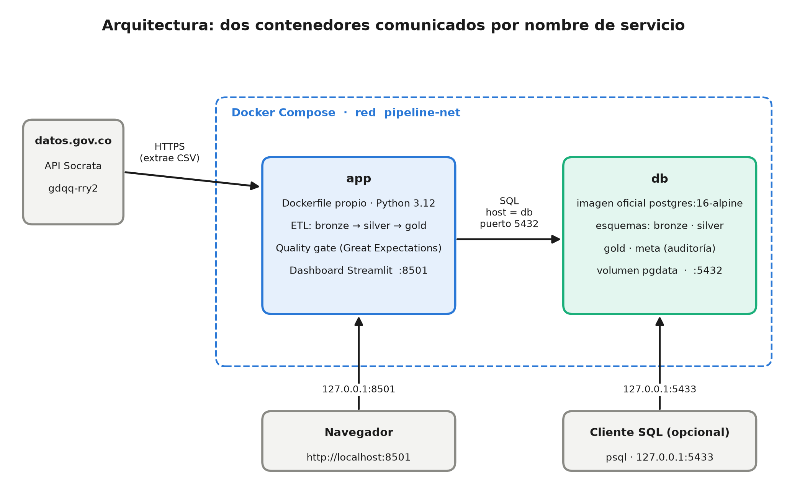
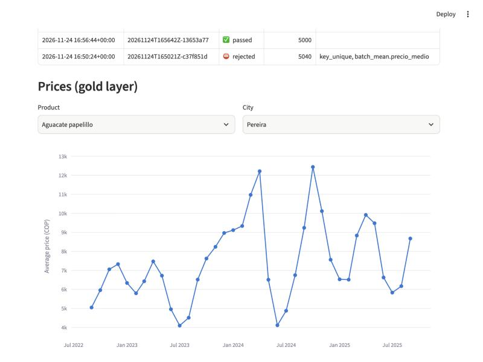
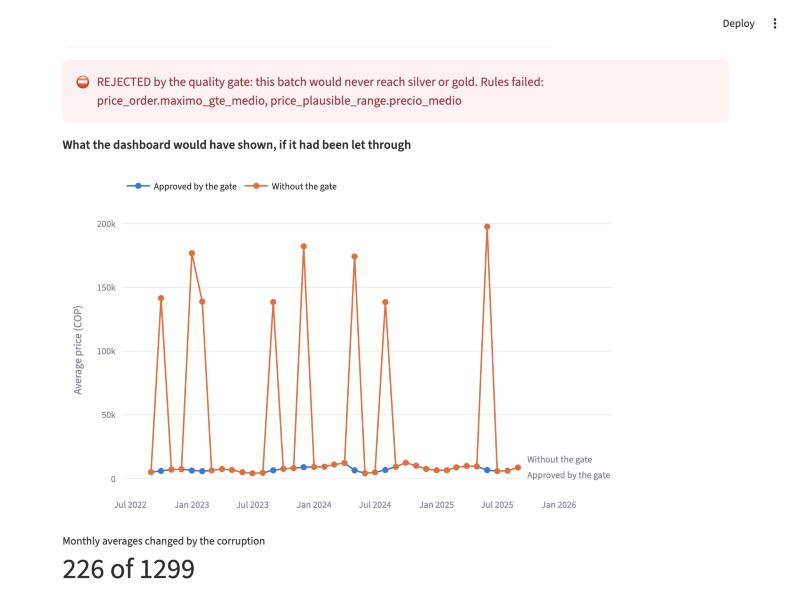

**Autor:** [PENDIENTE (TÚ): nombre completo y código]{.mark}

**Curso:** Integración Continua

**Fecha:** [PENDIENTE (TÚ): fecha de entrega]{.mark}

> **Antes de entregar (borra este cuadro).** Todo lo marcado en amarillo lo debes hacer tú:
>
> 1. [Tu nombre, código y fecha en esta portada.]{.mark}
> 2. [Pegar tus 5 capturas de pantalla en la sección 7. Ya está la salida real en texto de cada
>    comando para que compares, pero las capturas deben salir de tu máquina: son la evidencia de
>    tu entorno.]{.mark}
> 3. [Revisar que el enlace del repositorio y la sección 9 (registro de IA) reflejen tu trabajo.]{.mark}
> 4. [Borrar este cuadro y las instrucciones en amarillo.]{.mark}

## 1. Repositorio

<https://github.com/JsMorales0301/eje-cafetero-quality-gate>

Repositorio público con el código, el Dockerfile, el `docker-compose.yml` (dos contenedores y su
red), el README para levantar el sistema y ejecutar la operación de ejemplo, y los commits del
trabajo.

## 2. Qué hace el proyecto

Es un pipeline de datos de punta a punta: extrae precios mayoristas de alimentos del Eje
Cafetero desde datos.gov.co, valida su calidad, los carga por capas (bronze, silver, gold) y los
muestra en un dashboard.

La idea central que demuestra es **cómo un dato corrupto puede dañar decisiones y dar falsas
expectativas si no pasa pruebas de calidad.** Con datos aprobados, el mayor aumento de precio real
del último mes es Pitahaya (+54,3 %). Si un lote con ceros de más en el 5 % de las filas se saltara
el control, aparecería Manzana roja importada con +2.305 % (una falsa alarma) y la Pitahaya real
desaparecería del ranking. Con el control de calidad, ese lote se rechaza y el dashboard nunca lo
ve.

## 3. Qué hace cada contenedor

| Contenedor | Imagen | Función |
|---|---|---|
| `app` | Dockerfile propio sobre `python:3.12-slim` | Extrae los datos, ejecuta el control de calidad (Great Expectations), carga las capas y sirve el dashboard (Streamlit, puerto 8501). |
| `db` | `postgres:16-alpine` (imagen oficial) | Guarda las capas `bronze`, `silver`, `gold` y la auditoría `meta`. Tiene un *healthcheck* con `pg_isready`. |

**Por qué estas imágenes.**
`postgres:16-alpine` es la imagen oficial de la base de datos: no hay que mantener un Dockerfile
para ella, y la variante Alpine es pequeña. `python:3.12-slim` es la base del contenedor propio:
se fijó la versión 3.12 porque con el Python 3.15 de mi equipo `pip` solo ofrecía Great
Expectations 0.18, mientras que con 3.12 ofrece la 1.25 que usa el proyecto (se comprobó
consultando `pip index versions`), y `slim` evita paquetes que no se usan. El contenedor corre
con un usuario sin privilegios y las dependencias están fijadas con versión exacta.

## 4. Cómo se comunican



Los dos servicios están en la misma red de Docker Compose (`pipeline-net`). `app` encuentra a `db`
**por el nombre del servicio** (`host=db`, puerto 5432), no por una IP fija; Docker resuelve ese
nombre con su DNS interno.

**Orden de arranque.** `app` declara `depends_on` de `db` con la condición `service_healthy`:
Compose no arranca `app` hasta que `pg_isready` confirma que PostgreSQL acepta conexiones. Sin
esa condición, `app` podría intentar conectar mientras la base todavía se inicia.

**Credenciales.** Van en un archivo `.env` que no se sube al repositorio; el README indica qué
variables crear (`.env.example`). Los puertos publicados (8501 y 5433) escuchan solo en
`127.0.0.1`.

## 5. Flujo de datos


El lote crudo entra a **bronze** sin tocarlo. El **quality gate** aplica 22 expectativas (nulos,
rangos de precio, orden mínimo ≤ medio ≤ máximo, fechas, categorías, ciudades, clave única y
promedio del lote). Si pasa, se tipa en **silver** y se agrega en **gold**; si no, el lote se
rechaza, **silver y gold conservan el último lote aprobado** y la ejecución queda registrada con
las reglas que fallaron.

## 6. Cómo reproducirlo

Resumen (el detalle y los errores comunes están en el README del repositorio):

```bash
git clone https://github.com/JsMorales0301/eje-cafetero-quality-gate.git
cd eje-cafetero-quality-gate
cp .env.example .env            # y cambia POSTGRES_PASSWORD
docker compose build app
docker compose up -d db
docker compose run --rm app python -m pipeline.run --source fixture
```

## 7. Evidencias

Para cada evidencia se muestra el comando, la **salida real** obtenida al seguir el README desde
un clon limpio del repositorio (ver la sección 8) y un espacio marcado para tu captura.

### Captura 1. Contenedores en ejecución

Comando: `docker compose ps`. Deben verse `app` y `db` con estado `Up`, y `db` en `healthy`.
Salida real (con el formato de tabla corto; en tu máquina los nombres llevarán el de tu carpeta):

```text
SERVICE   STATUS                    PORTS
app       Up 2 seconds              127.0.0.1:8501->8501/tcp
db        Up 37 seconds (healthy)   127.0.0.1:5433->5432/tcp
```

[PENDIENTE (TÚ): pegar aquí tu captura 1 de `docker compose ps`.]{.mark}

### Captura 2. Guardar un dato

Comando: `docker compose run --rm app python -m pipeline.run --source fixture`. Salida real:

```text
STAGE extract     OK     source=fixture rows=30
STAGE bronze      OK     batch=20261124T203123Z-73542613 rows=30
STAGE quality_gate OK     expectations=22 silver_rows=30
STAGE gold        OK     precio_mensual=24
RESULT OK bronze=30 silver=30 gold=24
```

[PENDIENTE (TÚ): pegar aquí tu captura 2.]{.mark}

### Captura 3. Consultar el dato (los dos contenedores trabajando juntos)

Comando: `docker compose exec db psql -U pipeline -d canasta -c "SELECT producto, ciudad, mes, precio_promedio, observaciones FROM gold.precio_mensual WHERE producto = 'Patilla';"`. Salida real:

```text
 producto | ciudad  |    mes     | precio_promedio | observaciones
----------+---------+------------+-----------------+---------------
 Patilla  | Pereira | 2024-03-01 |         2090.00 |             1
(1 row)
```

[PENDIENTE (TÚ): pegar aquí tu captura 3.]{.mark}

### Captura 4. Un lote corrupto es bloqueado

Comando: `docker compose run --rm app python -m pipeline.run --source fixture --corrupt duplicates`.
Salida real (el código de salida es 1, y silver conserva sus 30 filas):

```text
STAGE extract     OK     source=fixture rows=30
STAGE corrupt     OK     kinds=duplicates seed=42 rows=31
STAGE bronze      OK     batch=20261124T203125Z-d8448118 rows=31
STAGE quality_gate FAILED failed=1/22 expectations; silver and gold keep the last approved data
  - key_unique unexpected=2 observed=None
RESULT FAILED stage=quality_gate exit=1
```

[PENDIENTE (TÚ): pegar aquí tu captura 4.]{.mark}

### Captura 5. Dashboard

Con datos reales cargados (`--source live`), el dashboard en <http://localhost:8501> muestra el
historial del quality gate, los precios por producto y ciudad, y la sección que compara lo que
se vería con y sin el control. Las cuatro imágenes siguientes son capturas reales de la
aplicación en ejecución, tomadas durante el desarrollo con 5000 filas reales.







[PENDIENTE (TÚ, opcional): reemplazar estas capturas por unas tuyas, tomadas en tu navegador, para
que la evidencia sea de tu propio entorno.]{.mark}

## 8. Validación desde una carpeta limpia

Para comprobar que otra persona puede reproducir el trabajo, se siguió el README **al pie de la
letra**, ejecutando cada comando exactamente como está escrito, sobre un clon del repositorio
público descargado desde GitHub sin credenciales. Resultado:

| Comprobación | Resultado |
|---|---|
| Repositorio público (sin sesión de GitHub) | Sí: la página responde, y `ls-remote` y `clone` funcionan de forma anónima. |
| Credenciales en el repositorio | Ninguna. `.env` no está versionado ni lo estuvo nunca; un barrido de todo el historial no encontró contraseñas, tokens ni claves (solo el valor de ejemplo de `.env.example`). |
| `db` sano con el puerto 5433 publicado | Sí. |
| Operación de ejemplo | `bronze=30 silver=30 gold=24`; la fila de Patilla es idéntica al bloque del README. |
| Lote corrupto | Termina con código 1 y silver conserva sus 30 filas. |
| Datos reales | `bronze=5000 silver=5000 gold=1299`. |
| Dashboard | Responde en `http://localhost:8501`. |
| Pruebas | 119 pasan. |

El README también se verificó en GitHub: los dos diagramas Mermaid y las tablas se dibujan bien.

## 9. Registro de uso de IA

**Herramienta.** Claude Code Desktop (modelo Claude Sonnet 5.5), configurado con Gentle AI
(instrucciones, skills y memoria persistente sobre el mismo modelo; no es otro modelo). La
revisión de cada cambio de riesgo medio o alto la realiza Gentle AI, con mi consentimiento por
cambio.

**Regla de verificación.** Todo resultado propuesto por la IA se ejecutó en mi entorno y se
contrastó con la salida real antes de aceptarlo.

**Para qué se usó y cómo evolucionaron los prompts.** Cada tarea tuvo un prompt inicial y, cuando
la revisión o la verificación encontraron fallos, un prompt de corrección. El registro completo
está en [`docs/ai-log.md`](https://github.com/JsMorales0301/eje-cafetero-quality-gate/blob/main/docs/ai-log.md).

| Tarea | Prompt inicial (resumen) | Qué hubo que corregir | Revisión de Gentle AI |
|---|---|---|---|
| T1. Extracción y bronze | Extraer de la API con paginación y cargar crudo a bronze. | Un helper de mis pruebas desplazaba columnas. | No se ejecutó. |
| T2. Silver y quality gate | Tipar, validar con Great Expectations y bloquear lotes malos. | Las pruebas borraban el silver real; un fallo de carga no quedaba auditado. | Aprobada dos veces; un candidato de solo documentación se omitió. |
| T3. Capa gold | Agregados mensuales y variación, comprobados contra pandas. | Una prueba de la semana no demostraba lo que decía. | Aprobada dos veces; la rama final se omitió. |
| T4. Orquestador | `pipeline.run` con códigos de salida y corrupción reproducible. | Un error de configuración salía con el mismo código que el gate. | Aprobada dos veces. |
| T5. Dashboard | Streamlit sobre gold con "qué pasaría sin el gate". | Etiquetas superpuestas y tablas cortadas, vistas solo al abrir el navegador. | Se omitió. |
| T6. README, diagramas e informe | README verificado, diagramas y borrador del informe. | Una afirmación falsa en el README sobre la falta de `.env`; etiquetas de los diagramas que cortaban bordes. | Se omitió. |
| T7. Validación desde carpeta limpia | Seguir el README al pie de la letra desde GitHub. | Una afirmación del informe sobre Python y Great Expectations que no estaba comprobada. | Riesgo bajo: cerrada sin lentes; el cierre formal (acknowledgement) quedó pendiente. |

**Errores de la IA detectados.** El detalle de cada uno (qué dijo la IA, qué mostró la salida real
y cómo se corrigió) está en `docs/ai-log.md`. Los más relevantes: una prueba "x10" que en realidad
multiplicaba por 1000, una comprobación de "silver intacto" que salió débil porque la suite
anterior ya lo había vaciado, un contrato de códigos de salida que no se cumplía antes de la
primera etapa, y una afirmación del README sobre la falta de `.env` que resultó falsa al
reproducirla.

[PENDIENTE (TÚ): leer esta sección y confirmar que describe fielmente cómo usaste la IA. Si usaste
otra herramienta o hiciste algo distinto, corrígelo antes de entregar.]{.mark}

## 10. Limitaciones

- El control de calidad no detecta todo: si solo se infla `precio_maximo` conservando el orden y el
  rango plausible, el lote pasa. Un control reduce el riesgo, no lo elimina.
- Un error de unidad (todos los precios por 10) no se detecta en la muestra de 30 filas, pero sí en
  un lote realista de 5000 filas.
- Las capturas de pantalla del dashboard (sección 7) se tomaron en el navegador integrado de la
  herramienta durante el desarrollo; las de terminal no se incluyen como imagen porque deben salir
  de tu propia máquina.
