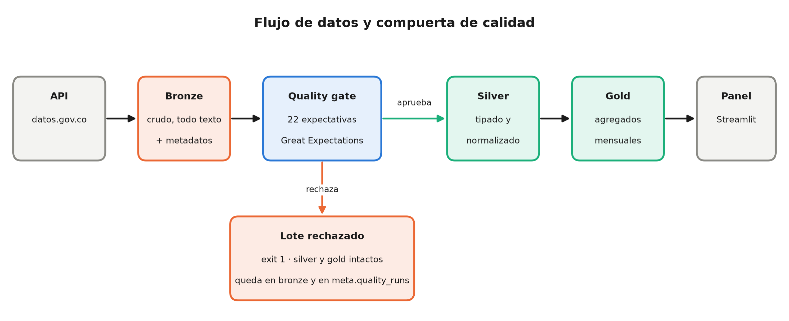
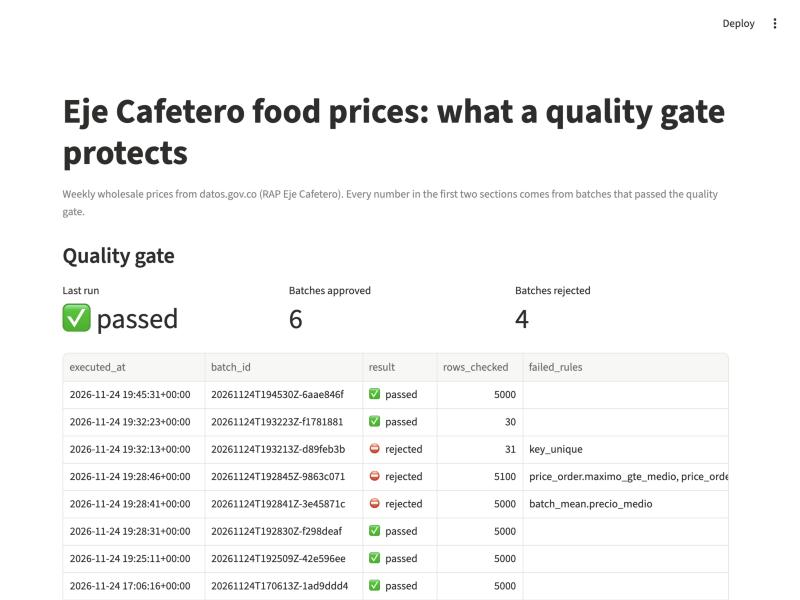
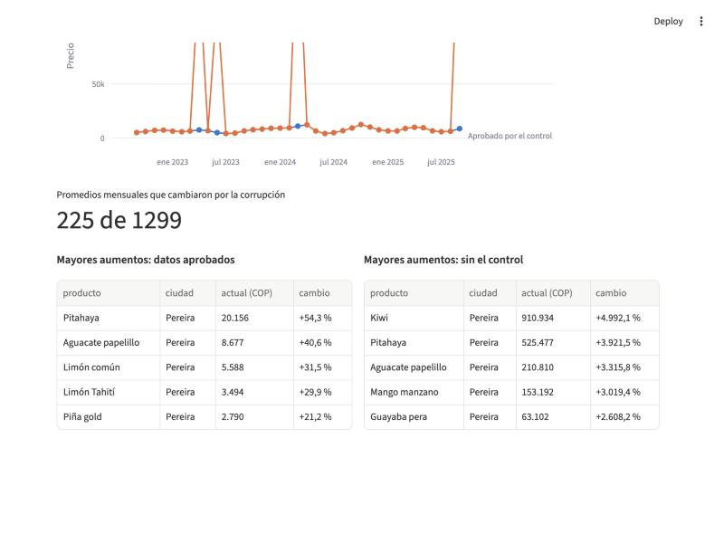

::: {custom-style="Block Text"}
**Antes de entregar (borra esta página).** Todo lo marcado en amarillo lo debes hacer tú:

1. [Completar la portada: tu nombre, institución y programa, docente y fecha.]{.mark}
2. [Pegar tus 4 capturas de terminal en la sección "Evidencias". Ya está la salida real en texto
   de cada comando para que compares, pero las capturas deben salir de tu máquina: son la
   evidencia de tu entorno.]{.mark}
3. [Confirmar con la docente si exige formato APA 7 para este escenario: la guía del Escenario 3
   no lo pide de forma explícita (sí lo pide la del Escenario 5), pero este documento ya está en
   APA 7.]{.mark}
4. [Verificar en la sección "Referencias" cómo se cita a Helena Holmström Olsson (apellido
   compuesto) en tu biblioteca o en la página del artículo.]{.mark}
5. [Leer la sección "Registro de uso de IA" y confirmar que describe fielmente cómo usaste la
   IA.]{.mark}
6. [Revisar la longitud: la guía pide un documento breve y la sección de conceptos lo alarga.
   Con el formato APA (doble espacio) puedes recortarla si hace falta.]{.mark}
7. [Abrir el archivo en Word y revisar que el formato se vea bien; no pude visualizarlo desde
   aquí.]{.mark}
8. [Borrar esta página y las marcas amarillas.]{.mark}
:::

```{=openxml}
<w:p><w:r><w:br w:type="page"/></w:r></w:p>
```

::: {custom-style="Portada"}
&nbsp;

&nbsp;

&nbsp;
:::

::: {custom-style="Portada Titulo"}
Proyecto en dos contenedores comunicados con Docker: pipeline de datos con control de calidad
:::

::: {custom-style="Portada"}
[PENDIENTE (TÚ): nombre completo]{.mark}

[PENDIENTE (TÚ): institución y programa]{.mark}

Integración Continua

[PENDIENTE (TÚ): nombre del docente]{.mark}

[PENDIENTE (TÚ): fecha de entrega]{.mark}
:::

```{=openxml}
<w:p><w:r><w:br w:type="page"/></w:r></w:p>
```

::: {custom-style="Portada Titulo"}
Proyecto en dos contenedores comunicados con Docker: pipeline de datos con control de calidad
:::

# Repositorio

El código, el Dockerfile, el archivo de Docker Compose con los dos contenedores y su red, y el
README con las instrucciones para levantar el sistema y ejecutar la operación de ejemplo están
en un repositorio público de GitHub: <https://github.com/JsMorales0301/eje-cafetero-quality-gate>

# Descripción del proyecto

El proyecto es un *pipeline* de datos de punta a punta: extrae precios mayoristas de alimentos
del Eje Cafetero desde datos.gov.co, valida su calidad, los carga por capas y los muestra en un
*dashboard*. Su propósito es demostrar cómo un dato corrupto puede dañar decisiones y dar falsas
expectativas si no pasa pruebas de calidad.

Con datos aprobados, el mayor aumento de precio real del último mes es el de la pitahaya
(+54,3 %). Si un lote con ceros de más en el 5 % de las filas se saltara el control, aparecería
la manzana roja importada con +2.305 %, una falsa alarma, y la pitahaya real desaparecería del
ranking. Con el control de calidad, ese lote se rechaza y el *dashboard* nunca lo ve.

# Conceptos de ingeniería de datos

Para que el proyecto se entienda sin conocimientos previos, esta sección explica los conceptos
que usa y señala dónde aparece cada uno en el repositorio.

## Ingeniería de datos y su ciclo de vida

Reis y Housley (2022) organizan el trabajo de la ingeniería de datos en un ciclo de vida de cinco
etapas (generación, almacenamiento, ingesta, transformación y servicio) y señalan corrientes que
lo atraviesan, entre ellas la seguridad, la gestión de datos, DataOps, la arquitectura de datos,
la orquestación y la ingeniería de software. En este proyecto, la generación es la fuente
datos.gov.co; la ingesta y el almacenamiento crudo son la capa *bronze*; la transformación son
las capas *silver* y *gold*; el servicio es el *dashboard*; y la orquestación es el comando
`pipeline.run`. Esta correspondencia es una interpretación propia, no una afirmación de los
autores.

## *Pipeline*, ETL y ELT

Un *pipeline* de datos es una secuencia automatizada de pasos que lleva los datos desde su origen
hasta quien los consume. En ETL (extraer, transformar, cargar) el dato se transforma antes de
guardarse; en ELT (extraer, cargar, transformar) se guarda primero el dato crudo y se transforma
después. Este proyecto guarda primero el dato crudo y lo transforma a partir de él, por lo que se
parece más al enfoque ELT.

## Arquitectura medallion

La documentación de Databricks (2026) describe la arquitectura *medallion* como tres capas que
indican la calidad del dato: *bronze* (crudo), *silver* (validado) y *gold* (enriquecido), con el
objetivo de mejorar de forma progresiva la estructura y la calidad del dato a medida que avanza
por ellas. La misma fuente la presenta como una práctica recomendada y no como un requisito. La
Tabla 1 muestra cómo se aplica en el proyecto.

::: {custom-style="Figura Etiqueta"}
Tabla 1
:::

::: {custom-style="Figura Titulo"}
Capas del proyecto y su relación con la arquitectura medallion
:::

| Capa | Qué contiene en el proyecto | Descripción de Databricks (2026) |
|:------|:--------------------------------------|:---------------------|
| `bronze` | Dato tal como llega, todo en texto, con metadatos del lote. | Dato crudo, sin validar. |
| `silver` | Precios y fechas tipados, solo de lotes que pasaron el control. | Dato validado y limpio. |
| `gold` | Precio promedio mensual y variación contra el mes anterior. | Vistas refinadas para analítica y paneles. |
| `meta` | Registro de cada ejecución del control de calidad. | No tiene equivalente directo; es propio del proyecto. |

## Calidad de datos

Wang y Strong (1996) mostraron, a partir de encuestas a consumidores de datos, que la calidad no
se reduce a la exactitud, y propusieron cuatro categorías: intrínseca, contextual, de
representación y de accesibilidad. En este proyecto, por ejemplo, las reglas contra nulos se
relacionan con la completitud (categoría contextual) y las reglas de rango y de orden de los
precios con la exactitud (categoría intrínseca). Esta asociación es una interpretación propia.

## Expectativas y control de calidad

Great Expectations (s. f.) define una *Expectation* como una afirmación verificable sobre los
datos y un *Checkpoint* como el medio principal para validar datos en un despliegue de
producción. En el proyecto, el *quality gate* (compuerta de calidad) es el conjunto de 22
expectativas que se evalúa sobre cada lote y que decide si este puede avanzar de *bronze* a
*silver*.

## Lote, auditoría y reconstrucción

Tres términos se usan aquí con el sentido que tienen en el proyecto. Un lote es cada
descarga de datos que se procesa como una unidad. La auditoría es el registro, en la tabla
`meta.quality_runs`, de cada ejecución del control con su resultado y las reglas que fallaron.
La reconstrucción es la capacidad de volver a calcular *gold* a partir de *silver* sin duplicar
filas.

# Integración continua y DataOps: un contraste

## Qué es la integración continua

Fowler (2024) la define como una práctica de desarrollo en la que cada integrante del equipo
integra sus cambios en una base de código compartida al menos una vez al día, y cada integración
se verifica con una compilación automática, que incluye pruebas, para detectar los errores de
integración lo antes posible. Entre las prácticas que enumera están hacer que la compilación se
verifique a sí misma con pruebas, que cada envío a la rama principal dispare una compilación y
corregir de inmediato las compilaciones rotas. La integración continua protege, ante todo, el
**código**.

## Qué es DataOps

Munappy et al. (2020) señalan que DataOps es un término reciente, con poca investigación y sin
una definición clara, y lo caracterizan, tras una revisión de literatura, como un proceso general
que busca acortar el tiempo del ciclo de vida completo de la analítica de datos mediante
automatización en la recolección, la validación y la verificación. El *DataOps Manifesto*
(DataKitchen, s. f.) reúne 18 principios; entre ellos figuran "Analytics is code", "Make it
reproducible", "Quality is paramount" y "Monitor quality and performance", además de la
recomendación de empezar por pruebas de datos. Entre sus valores está la propiedad
multifuncional de las operaciones frente a las responsabilidades aisladas. Conviene notar que el
manifiesto es un documento de practicantes, creado y mantenido por la empresa DataKitchen, y no
una fuente arbitrada; por eso se contrasta aquí con Munappy et al. (2020).

## El contraste

La Tabla 2 compara ambos enfoques y los relaciona con el proyecto.

::: {custom-style="Figura Etiqueta"}
Tabla 2
:::

::: {custom-style="Figura Titulo"}
Integración continua frente a DataOps, y su aplicación en el proyecto
:::

| Aspecto | Integración continua | DataOps | En este proyecto |
|:--------|:-------------------------|:-------------------------|:------------------------|
| Qué protege | La integración de cambios de código en una base compartida (Fowler, 2024). | El ciclo completo de la analítica: código, datos y el *pipeline* que los mueve (Munappy et al., 2020). | `pytest` protege el código; el control de calidad protege los datos. |
| Qué se prueba | El código, con una compilación automática que incluye pruebas (Fowler, 2024). | El código ("Analytics is code") y también los datos que fluyen (DataKitchen, s. f.). | 119 pruebas de código y 22 expectativas sobre cada lote. |
| Cuándo se ejecutan las pruebas | Cuando alguien integra un cambio en la rama principal (Fowler, 2024). | Cuando cambia el código y cada vez que llegan datos nuevos. | `pytest` al cambiar el código; el control, en cada ejecución de `pipeline.run`. |
| Qué significa una falla | Un error de integración o un defecto del cambio, que se corrige de inmediato (Fowler, 2024). | Un defecto en el código o en el dato, que se detecta y se vigila de forma continua (DataKitchen, s. f.). | Código de salida 1: el lote se rechaza y *silver* y *gold* conservan lo aprobado. |

## Cómo se complementan

La integración continua responde a la pregunta "¿mi cambio rompió algo?", y DataOps agrega
"¿el dato que llegó hoy es confiable?". No se reemplazan, porque cubren fallas distintas: un
código correcto puede producir resultados falsos con datos malos, y datos perfectos no salvan a
un código defectuoso. El *dashboard* del proyecto lo demuestra: el código es el mismo con y sin
el lote corrupto, y lo único que cambia es el dato, pero la decisión que se tomaría con el
ranking de aumentos de precio sería otra. Este razonamiento es un análisis propio, apoyado en
las definiciones anteriores.

En el Escenario 5, Jenkins aportará la parte de integración continua: construirá y probará el
proyecto ante cada cambio. Está previsto que la falla provocada sea cargar el lote corrupto, de
modo que la compilación falle porque el control de calidad lo detiene. Eso unirá ambos mundos,
pero todavía no está implementado.

# Contenedores

El proyecto corre en dos contenedores (Tabla 3).

::: {custom-style="Figura Etiqueta"}
Tabla 3
:::

::: {custom-style="Figura Titulo"}
Contenedores del proyecto
:::

| Contenedor | Imagen | Función |
|:-------|:----------------------|:----------------------------------|
| `app` | Dockerfile propio sobre `python:3.12-slim` | Extrae los datos, ejecuta el control de calidad (Great Expectations), carga las capas y sirve el *dashboard* (Streamlit, puerto 8501). |
| `db` | `postgres:16-alpine` (imagen oficial) | Guarda las capas `bronze`, `silver`, `gold` y la auditoría `meta`. Tiene un *healthcheck* con `pg_isready`. |

`postgres:16-alpine` es la imagen oficial de la base de datos: no hay que mantener un Dockerfile
para ella, y la variante Alpine es pequeña. `python:3.12-slim` es la base del contenedor propio:
se fijó la versión 3.12 porque, con el Python 3.15 de mi equipo, `pip` solo ofrecía Great
Expectations 0.18, mientras que con 3.12 ofrece la 1.25 que usa el proyecto (se comprobó
consultando `pip index versions`), y la variante `slim` evita paquetes que no se usan. El
contenedor corre con un usuario sin privilegios y las dependencias están fijadas con versión
exacta.

# Comunicación entre contenedores

::: {custom-style="Figura Etiqueta"}
Figura 1
:::

::: {custom-style="Figura Titulo"}
Arquitectura: dos contenedores comunicados por nombre de servicio
:::


Los dos servicios están en la misma red de Docker Compose (`pipeline-net`). El contenedor `app`
encuentra a `db` por el nombre del servicio (`host=db`, puerto 5432) y no por una dirección IP
fija; Docker resuelve ese nombre con su DNS interno.

Respecto del orden de arranque, Docker (s. f.) explica que, por defecto, Compose no espera a que
un contenedor esté "listo", solo a que esté en ejecución, y que la condición `service_healthy`
hace esperar a que la dependencia supere su *healthcheck* antes de crear el servicio que
depende de ella. El proyecto usa esa condición: `app` declara `depends_on` de `db` con
`service_healthy`, y `db` define `pg_isready` como *healthcheck*. Así, `app` no arranca mientras
PostgreSQL todavía se está iniciando.

Las credenciales van en un archivo `.env` que no se sube al repositorio; el README indica qué
variables crear (`.env.example`). Los puertos publicados (8501 y 5433) escuchan solo en
`127.0.0.1`.

# Flujo de datos

::: {custom-style="Figura Etiqueta"}
Figura 2
:::

::: {custom-style="Figura Titulo"}
Flujo de datos y compuerta de calidad
:::



El lote crudo entra a *bronze* sin modificarse. El control de calidad aplica 22 expectativas
(nulos, rangos de precio, orden mínimo ≤ medio ≤ máximo, fechas, categorías, ciudades, clave
única y promedio del lote). Si el lote pasa, se tipa en *silver* y se agrega en *gold*; si no, se
rechaza, *silver* y *gold* conservan el último lote aprobado y la ejecución queda registrada con
las reglas que fallaron.

# Reproducción

El detalle y los errores comunes están en el README del repositorio. En resumen:

```bash
git clone https://github.com/JsMorales0301/eje-cafetero-quality-gate.git
cd eje-cafetero-quality-gate
cp .env.example .env            # y cambia POSTGRES_PASSWORD
docker compose build app
docker compose up -d db
docker compose run --rm app python -m pipeline.run --source fixture
```

# Evidencias

Para cada evidencia se muestra el comando, la salida real obtenida al seguir el README desde un
clon limpio del repositorio (ver la sección "Validación desde una carpeta limpia") y un espacio
marcado para la captura de pantalla.

## Captura 1. Contenedores en ejecución

El comando `docker compose ps` debe mostrar `app` y `db` con estado `Up`, y `db` en `healthy`.
Salida real, con el formato de tabla corto (en cada equipo los nombres llevan el de la carpeta):

```text
SERVICE   STATUS                    PORTS
app       Up 2 seconds              127.0.0.1:8501->8501/tcp
db        Up 37 seconds (healthy)   127.0.0.1:5433->5432/tcp
```

[PENDIENTE (TÚ): pegar aquí tu captura 1 de `docker compose ps`.]{.mark}

## Captura 2. Guardar un dato

Comando: `docker compose run --rm app python -m pipeline.run --source fixture`. Salida real:

```text
STAGE extract     OK     source=fixture rows=30
STAGE bronze      OK     batch=20261124T203123Z-73542613 rows=30
STAGE quality_gate OK     expectations=22 silver_rows=30
STAGE gold        OK     precio_mensual=24
RESULT OK bronze=30 silver=30 gold=24
```

[PENDIENTE (TÚ): pegar aquí tu captura 2.]{.mark}

## Captura 3. Consultar el dato

Comando (los dos contenedores trabajando juntos: `app` escribió y `db` responde):

```bash
docker compose exec db psql -U pipeline -d canasta -c "SELECT producto, ciudad, mes, precio_promedio, observaciones FROM gold.precio_mensual WHERE producto = 'Patilla';"
```

Salida real:

```text
 producto | ciudad  |    mes     | precio_promedio | observaciones
----------+---------+------------+-----------------+---------------
 Patilla  | Pereira | 2024-03-01 |         2090.00 |             1
(1 row)
```

[PENDIENTE (TÚ): pegar aquí tu captura 3.]{.mark}

## Captura 4. Un lote corrupto es bloqueado

Comando: `docker compose run --rm app python -m pipeline.run --source fixture --corrupt duplicates`.
Salida real (el código de salida es 1 y *silver* conserva sus 30 filas):

```text
STAGE extract     OK     source=fixture rows=30
STAGE corrupt     OK     kinds=duplicates seed=42 rows=31
STAGE bronze      OK     batch=20261124T203125Z-d8448118 rows=31
STAGE quality_gate FAILED failed=1/22 expectations; silver and gold keep the last approved data
  - key_unique unexpected=2 observed=None
RESULT FAILED stage=quality_gate exit=1
```

[PENDIENTE (TÚ): pegar aquí tu captura 4.]{.mark}

## Dashboard

Con datos reales cargados (`--source live`), el *dashboard* en <http://localhost:8501> muestra el
historial del control de calidad, los precios por producto y ciudad, y una sección que compara
lo que se vería con y sin el control. Las Figuras 3 a 6 son capturas reales de la aplicación en
ejecución, tomadas durante el desarrollo con 5000 filas reales.

::: {custom-style="Figura Etiqueta"}
Figura 3
:::

::: {custom-style="Figura Titulo"}
Historial del control de calidad: lotes aprobados y rechazados, con las reglas que fallaron
:::



::: {custom-style="Figura Etiqueta"}
Figura 4
:::

::: {custom-style="Figura Titulo"}
Precio promedio mensual de un producto y una ciudad, desde la capa gold
:::


::: {custom-style="Figura Etiqueta"}
Figura 5
:::

::: {custom-style="Figura Titulo"}
Con el 5 % de las filas con ceros de más, el control rechaza el lote; sin él aparecerían picos falsos de hasta 200 mil COP
:::


::: {custom-style="Figura Etiqueta"}
Figura 6
:::

::: {custom-style="Figura Titulo"}
Mayores aumentos de precio con y sin el control de calidad
:::



*Nota.* Con datos aprobados lidera la pitahaya (+54,3 %). Sin el control aparece una falsa alarma
de +2.305 % y la pitahaya desaparece del ranking.

[PENDIENTE (TÚ, opcional): reemplazar las Figuras 3 a 6 por capturas tuyas, tomadas en tu
navegador, para que la evidencia sea de tu propio entorno.]{.mark}

# Validación desde una carpeta limpia

Para comprobar que otra persona puede reproducir el trabajo, se siguió el README al pie de la
letra, ejecutando cada comando exactamente como está escrito, sobre un clon del repositorio
público descargado desde GitHub sin credenciales. La Tabla 4 resume el resultado.

::: {custom-style="Figura Etiqueta"}
Tabla 4
:::

::: {custom-style="Figura Titulo"}
Resultado de seguir el README desde un clon limpio
:::

| Comprobación | Resultado |
|:---------------------------|:----------------------------------------------------|
| Repositorio público (sin sesión de GitHub) | Sí: la página responde, y `ls-remote` y `clone` funcionan de forma anónima. |
| Credenciales en el repositorio | Ninguna. `.env` no está versionado ni lo estuvo nunca; un barrido de todo el historial no encontró contraseñas, tokens ni claves (solo el valor de ejemplo de `.env.example`). |
| `db` sano con el puerto 5433 publicado | Sí. |
| Operación de ejemplo | `bronze=30 silver=30 gold=24`; la fila de Patilla es idéntica al bloque del README. |
| Lote corrupto | Termina con código 1 y *silver* conserva sus 30 filas. |
| Datos reales | `bronze=5000 silver=5000 gold=1299`. |
| *Dashboard* | Responde en `http://localhost:8501`. |
| Pruebas | 119 pasan. |

El README también se verificó en GitHub: los dos diagramas Mermaid y las tablas se dibujan bien.

# Registro de uso de IA

La herramienta es Claude Code Desktop (modelo Claude Sonnet 5.5), configurada con Gentle AI
(instrucciones, *skills* y memoria persistente sobre el mismo modelo; no es otro modelo). La
revisión de cada cambio de riesgo medio o alto la realiza Gentle AI, con mi consentimiento por
cambio. Todo resultado propuesto por la IA se ejecutó en mi entorno y se contrastó con la salida
real antes de aceptarlo.

Cada tarea tuvo un prompt inicial y, cuando la revisión o la verificación encontraron fallos, un
prompt de corrección. El registro completo, con los prompts y los errores de la IA, está en
`docs/ai-log.md` del repositorio. La Tabla 5 lo resume.

::: {custom-style="Figura Etiqueta"}
Tabla 5
:::

::: {custom-style="Figura Titulo"}
Uso de IA por tarea
:::

| Tarea | Prompt inicial (resumen) | Qué hubo que corregir | Revisión de Gentle AI |
|:----------|:--------------------------|:---------------------------|:-------------------|
| T1. Extracción y bronze | Extraer de la API con paginación y cargar crudo a bronze. | Un auxiliar de mis pruebas desplazaba columnas. | No se ejecutó. |
| T2. Silver y control de calidad | Tipar, validar con Great Expectations y bloquear lotes malos. | Las pruebas borraban el silver real; un fallo de carga no quedaba auditado. | Aprobada dos veces; un candidato de solo documentación se omitió. |
| T3. Capa gold | Agregados mensuales y variación, comprobados contra pandas. | Una prueba de la semana no demostraba lo que decía. | Aprobada dos veces; la rama final se omitió. |
| T4. Orquestador | `pipeline.run` con códigos de salida y corrupción reproducible. | Un error de configuración salía con el mismo código que el control. | Aprobada dos veces. |
| T5. *Dashboard* | Streamlit sobre gold con "qué pasaría sin el control". | Etiquetas superpuestas y tablas cortadas, vistas solo al abrir el navegador. | Se omitió. |
| T6. README, diagramas e informe | README verificado, diagramas y borrador del informe. | Una afirmación falsa en el README sobre la falta de `.env`; etiquetas de diagramas que cortaban bordes. | Se omitió. |
| T7. Validación en carpeta limpia | Seguir el README al pie de la letra desde GitHub. | Una afirmación del informe sobre Python y Great Expectations que no estaba comprobada. | Riesgo bajo: cerrada sin lentes; el cierre formal quedó pendiente. |
| Ampliación del informe | Formato APA 7, conceptos de ingeniería de datos y contraste entre integración continua y DataOps. | Las fuentes se verificaron leyendo las páginas primarias; se descartó una fuente por no poder confirmar el nombre de su autor. | Pendiente. |

Los errores más relevantes de la IA fueron una prueba "x10" que en realidad multiplicaba por 1000,
una comprobación de "silver intacto" que salió débil porque la suite anterior ya lo había vaciado,
un contrato de códigos de salida que no se cumplía antes de la primera etapa y una afirmación del
README sobre la falta de `.env` que resultó falsa al reproducirla.

[PENDIENTE (TÚ): leer esta sección y confirmar que describe fielmente cómo usaste la IA. Si usaste
otra herramienta o hiciste algo distinto, corrígelo antes de entregar.]{.mark}

# Limitaciones

El control de calidad no detecta todo: si solo se infla `precio_maximo` conservando el orden y el
rango plausible, el lote pasa, de modo que un control reduce el riesgo pero no lo elimina. Un
error de unidad (todos los precios por 10) no se detecta en la muestra de 30 filas, pero sí en
un lote realista de 5000 filas. Las capturas del *dashboard* se tomaron en el navegador integrado
de la herramienta durante el desarrollo, y las de terminal no se incluyen como imagen porque
deben salir de la máquina de quien entrega. Por último, la conexión entre integración continua y
control de datos descrita en el contraste está prevista para el Escenario 5 y aún no existe.

```{=openxml}
<w:p><w:r><w:br w:type="page"/></w:r></w:p>
```

# Referencias

::: {custom-style="Referencia"}
Databricks. (2026, 19 de noviembre). *What is the medallion lakehouse architecture?* <https://docs.databricks.com/aws/en/lakehouse/medallion>

DataKitchen. (s. f.). *The DataOps manifesto*. Recuperado el 24 de noviembre de 2026, de <https://dataopsmanifesto.org/en/>

Docker. (s. f.). *Control startup and shutdown order in Compose*. Recuperado el 24 de noviembre de 2026, de <https://docs.docker.com/compose/how-tos/startup-order/>

Fowler, M. (2024, 18 de enero). *Continuous integration*. <https://martinfowler.com/articles/continuousIntegration.html>

Great Expectations. (s. f.). *GX Core overview*. Recuperado el 24 de noviembre de 2026, de <https://docs.greatexpectations.io/docs/core/introduction/gx_overview/>

Munappy, A. R., Mattos, D. I., Bosch, J., Holmström Olsson, H. y Dakkak, A. (2020). From ad-hoc data analytics to DataOps. En *Proceedings of the 2020 IEEE/ACM International Conference on Software and System Processes* (pp. 165-174). Association for Computing Machinery. <https://doi.org/10.1145/3379177.3388909>

Reis, J. y Housley, M. (2022). *Fundamentals of data engineering: Plan and build robust data systems*. O'Reilly Media.

Wang, R. Y. y Strong, D. M. (1996). Beyond accuracy: What data quality means to data consumers. *Journal of Management Information Systems, 12*(4), 5-33. <https://doi.org/10.1080/07421222.1996.11518099>
:::

[PENDIENTE (TÚ): en Munappy et al. (2020) el apellido de la cuarta autora aparece como "Holmström
Olsson"; confirma en la página del artículo cómo se cita antes de entregar. En el texto se cita
como "Munappy et al., 2020".]{.mark}
