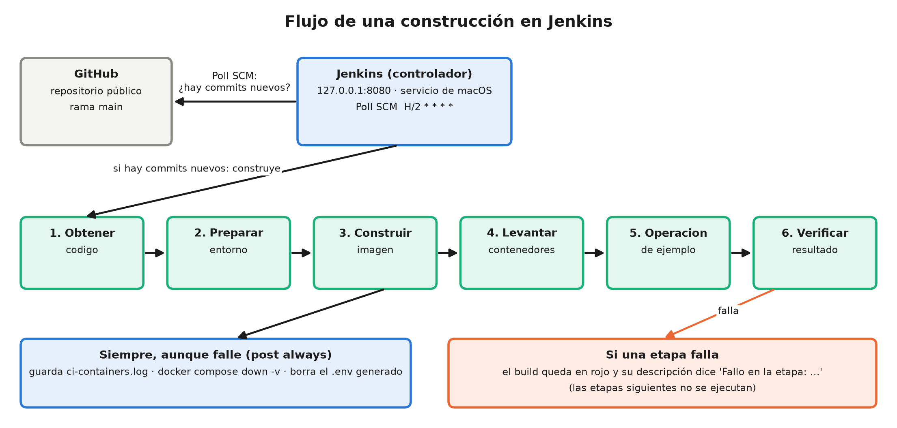

::: {custom-style="Block Text"}
**Antes de entregar (borra esta página).** Todo lo marcado en amarillo lo debes hacer tú:

1. [Completar la portada: tu nombre, institución y programa, docente y fecha.]{.mark}
2. [Tomar las capturas del historial de construcciones (sección "Prueba de la implementación").
   Necesitas: la página del job con el historial (construcciones 1 verde, 2 roja y 3 verde), la
   *Console Output* de la construcción 2 donde se ve la diferencia, y *Configurar > Triggers* con
   *Poll SCM* marcado. Que no salgan la clave inicial, tu contraseña ni el identificador de autor
   del commit (se ve en la página de cada construcción).]{.mark}
3. [Opcional: ejecutar *Build with Parameters* con `CORRUPT=duplicates` para tener también una
   falla en la etapa "Operacion de ejemplo", y actualizar la Tabla 5 con ese resultado.]{.mark}
4. [Leer la sección "Registro de uso de IA" y confirmar que describe fielmente cómo usaste la IA.]{.mark}
5. [Comprobar que los pasos de instalación corresponden a lo que hiciste en tu equipo.]{.mark}
6. [Abrir el archivo en Word y revisar que el formato se vea bien; no pude visualizarlo desde aquí.]{.mark}
7. [Borrar esta página y las marcas amarillas.]{.mark}
:::

```{=openxml}
<w:p><w:r><w:br w:type="page"/></w:r></w:p>
```

::: {custom-style="Portada"}
&nbsp;

&nbsp;

&nbsp;
:::

::: {custom-style="Portada Titulo"}
Jenkins como servidor de integración continua: requisitos e implementación
:::

::: {custom-style="Portada"}
[PENDIENTE (TÚ): nombre completo]{.mark}

[PENDIENTE (TÚ): institución y programa]{.mark}

Integración Continua

[PENDIENTE (TÚ): nombre del docente]{.mark}

[PENDIENTE (TÚ): fecha de entrega]{.mark}
:::

```{=openxml}
<w:p><w:r><w:br w:type="page"/></w:r></w:p>
```

::: {custom-style="Portada Titulo"}
Jenkins como servidor de integración continua: requisitos e implementación
:::

# Repositorio

El código, el `Jenkinsfile`, el archivo `docker-compose.ci.yml` y el README están en un
repositorio público de GitHub: <https://github.com/JsMorales0301/eje-cafetero-quality-gate>

# Descripción de la solución

Jenkins corre directamente en el computador, como un servicio, y vigila la rama `main` del
repositorio. Cuando detecta un commit nuevo, ejecuta el `Jenkinsfile`: obtiene el código,
construye la imagen, levanta los dos contenedores del proyecto (la aplicación y la base de datos
PostgreSQL), ejecuta la operación de ejemplo, verifica que su resultado sea el esperado y retira
todo. Si el resultado no es el esperado, la construcción falla y su descripción indica en qué
etapa.

La operación de ejemplo carga una muestra de 30 filas de precios de alimentos, la valida y la
agrega por producto, ciudad y mes. El resultado esperado (30 filas en cada capa y 24 promedios
mensuales, además de tres promedios calculados de forma independiente con pandas) está en el
archivo `data/sample/expected_fixture.json`, y el comando `pipeline.verify` termina con un código
distinto de cero si algo difiere.

::: {custom-style="Figura Etiqueta"}
Figura 1
:::

::: {custom-style="Figura Titulo"}
Flujo de una construcción en Jenkins
:::



# Requisitos de infraestructura

La Tabla 1 reúne lo que necesita la solución. La columna "Requisito de la fuente oficial" cita
lo que dice la documentación; la columna "Usado en este proyecto" muestra las versiones y los
valores medidos en el equipo donde se implementó.

::: {custom-style="Figura Etiqueta"}
Tabla 1
:::

::: {custom-style="Figura Titulo"}
Requisitos de infraestructura, con la versión usada y su fuente
:::

| Requisito | Requisito de la fuente oficial | Usado en este proyecto |
|:------------|:-------------------------------------|:---------------------------------|
| Sistema operativo | Docker Desktop admite la versión actual de macOS y las dos anteriores (Docker, s. f.-c). | macOS 27.0.1, arquitectura arm64. |
| Java | Jenkins admite Java 21 y Java 25; Java 17 figura como no admitido (Jenkins, s. f.-c). | OpenJDK 21.0.13.1, instalado por Homebrew como dependencia de `jenkins-lts` (Homebrew, s. f.). |
| Jenkins | Se instala con `brew install jenkins-lts` (Homebrew, s. f.). | Jenkins 2.580.2 (LTS). |
| Docker | Docker Desktop requiere al menos 4 GB de RAM (Docker, s. f.-c). | Docker Desktop 4.95.0; cliente y motor 29.8.2; Docker Compose 5.6.0. El motor tiene 7,7 GB y 10 CPU asignados. |
| Git | No aplica. | git 2.54.0 (Apple Git-157); lo usa Jenkins para obtener el código. |
| Puertos | Jenkins se abre en el puerto 8080 (Jenkins, s. f.-i). | 8080, solo en `127.0.0.1`. Las construcciones no publican puertos (Docker, s. f.-d). |
| Memoria RAM | Mínimo 256 MB; para un equipo pequeño se recomiendan 4 GB o más (Jenkins, s. f.-i). | 24 GB en el equipo. El controlador de Jenkins usa unos 1.314 MB (medido). |
| Disco | Mínimo 1 GB; se recomiendan 50 GB o más (Jenkins, s. f.-i). | 653 GB libres. Directorio de Jenkins: 262 MB. Imagen de la aplicación: 1,24 GB; `postgres:16-alpine`: 412 MB. |
| Internet | No aplica. | Para consultar GitHub y descargar imágenes y dependencias. La operación de ejemplo usa la muestra local y no necesita datos.gov.co. |

La cuenta con la que corre Jenkins necesita acceso a Docker. En macOS, Jenkins arranca como un
servicio de usuario de Homebrew, así que corre con la misma cuenta que tiene Docker Desktop y no
hay que agregarla a ningún grupo. Un servicio no hereda el `PATH` del shell, y Docker Desktop
instala sus herramientas de línea de comandos en `$HOME/.docker/bin` (Docker, s. f.-c); por eso el
`Jenkinsfile` agrega esa ruta al `PATH`.

# Requisitos de configuración

## Complementos (plugins)

Se instaló el conjunto sugerido por el asistente de Jenkins (92 complementos). La Tabla 2 muestra
los que usa el `Jenkinsfile`, con la versión instalada.

::: {custom-style="Figura Etiqueta"}
Tabla 2
:::

::: {custom-style="Figura Titulo"}
Complementos de Jenkins que usa el proyecto
:::

| Complemento | Versión instalada | Para qué lo usa este proyecto |
|:----------------------|:----------------------|:-----------------------------------|
| Pipeline (`workflow-aggregator`) | 608.v67378e9d3db_1 | Permite definir la construcción con un `Jenkinsfile`. |
| Pipeline: Declarative (`pipeline-model-definition`) | 2.2293.v6e7193cec599 | Sintaxis declarativa: `pipeline`, `options`, `parameters`, `post` (Jenkins, s. f.-f). |
| Git (`git`) y Git client (`git-client`) | 5.11.0 y 6.7.1 | Obtienen el código de GitHub (`checkout scm`). |
| Timestamper (`timestamper`) | 1.30 | Marca de tiempo en cada línea de la salida (`timestamps()`). |
| Credentials (`credentials`) | 1521.v1e4763284417 | Viene en el conjunto sugerido; este proyecto no guarda credenciales. |

No está instalado *Pipeline: Stage View*, así que Jenkins no muestra la vista por etapas; por eso
el `Jenkinsfile` escribe en la descripción de la construcción la etapa que falló.

## Usuario administrador

El asistente de configuración tiene tres pasos: desbloquear Jenkins con la clave inicial,
instalar los complementos sugeridos y crear el primer usuario administrador (Jenkins, s. f.-i).
La clave inicial está en el archivo `secrets/initialAdminPassword` dentro del directorio de
Jenkins, que en este equipo es `~/.jenkins`. El usuario y la contraseña los eligió quien
implementó la solución y **no se incluyen en este documento**.

Jenkins recomienda dejar siempre activada la seguridad en entornos que no sean solo de prueba y
no usar la autorización "Anyone can do anything", con la autorización por matriz como punto de
partida (Jenkins, s. f.-e). El acceso se define en dos ejes independientes: el *security realm*
(quién es cada usuario) y la estrategia de autorización (qué puede hacer) (Jenkins, s. f.-g).
Aquí se usa la base de usuarios propia de Jenkins, con un solo administrador.

## Credenciales

**La solución no guarda ninguna credencial.** El repositorio es público, así que el código se
obtiene sin credenciales. La contraseña de la base de datos se genera de nuevo en cada
construcción con `openssl rand -hex 16`, se escribe en un archivo `.env` con permisos restringidos
(`umask 077`), no se imprime en el registro porque el script usa un *shebang* que evita el
`set -x` por defecto de Jenkins, y se borra al terminar, incluso si la construcción falla.

Jenkins recomienda configurar las credenciales en Jenkins y referenciarlas desde el
`Jenkinsfile` en lugar de escribirlas en él, y advierte que no se debe usar la interpolación de
Groovy (cadenas con comillas dobles) con credenciales (Jenkins, s. f.-h). Este proyecto evita el
problema desde el diseño, porque no hay ninguna credencial que guardar. El único valor que se
interpola en un comando es el parámetro `CORRUPT`, que no es un secreto y que se valida con la
expresión `[a-z_,]+` antes de llegar al shell.

## Configuración del job

::: {custom-style="Figura Etiqueta"}
Tabla 3
:::

::: {custom-style="Figura Titulo"}
Configuración del job en Jenkins
:::

| Campo | Valor |
|:--------------------|:---------------------------------------------------|
| Nombre | `eje-cafetero-quality-gate` |
| Tipo | Pipeline |
| *Definition* | Pipeline script from SCM |
| *SCM* | Git |
| *Repository URL* | `https://github.com/JsMorales0301/eje-cafetero-quality-gate.git` |
| *Credentials* | Ninguna (repositorio público) |
| *Branch Specifier* | `*/main` |
| *Script Path* | `Jenkinsfile` |
| *Triggers* | No se marca a mano: el `Jenkinsfile` declara `pollSCM('H/2 * * * *')` y Jenkins lo registra tras la primera construcción. |
| Parámetros | Los declara el `Jenkinsfile` (`CORRUPT`); no se marca "Esta ejecución debe parametrizarse". |

Según la documentación, `pollSCM` recibe una expresión de tipo cron: Jenkins consulta el control
de versiones con esa frecuencia y, si hay cambios, vuelve a ejecutar el *pipeline*; la letra `H`
reparte la carga usando un valor derivado del nombre del job para que no todos los jobs disparen
a la vez (Jenkins, s. f.-f). La expresión `H/2 * * * *` significa "cada dos minutos, con un
desfase propio del job". Se comprobó en el archivo `config.xml` del job que, después de la primera
construcción, Jenkins registró un `SCMTrigger` con esa expresión.

El `Jenkinsfile` usa además estas opciones documentadas (Jenkins, s. f.-f): `timeout` de 20
minutos, `timestamps`, `disableConcurrentBuilds` y `buildDiscarder` con las últimas 20
construcciones, y una sección `post` con `always`, `success` y `failure`. Se usa `sh` porque el
sistema es macOS; la documentación indica que `sh` supone un sistema tipo Unix y que en Windows
se usaría `bat` (Jenkins, s. f.-h).

# Pasos de instalación repetibles

Los pasos reproducen lo que se ejecutó en el equipo de la implementación.

1. **Requisitos previos.** Tener Homebrew, Docker Desktop abierto y Git.
2. **Instalar Jenkins.** Homebrew instala también `openjdk@21` como dependencia (Homebrew, s. f.).
   La página de Jenkins para macOS aclara que el instalador de macOS se mantiene fuera del
   proyecto Jenkins (Jenkins, s. f.-d).

   ```bash
   brew install jenkins-lts
   ```

3. **Arrancar el servicio.** Homebrew lo deja iniciando también al abrir sesión.

   ```bash
   brew services start jenkins-lts
   ```

4. **Comprobar que responde** (en la implementación respondió a los 12 segundos):

   ```bash
   curl -s -o /dev/null -w "%{http_code}\n" http://127.0.0.1:8080/login
   ```

   Debe imprimir `200`.
5. **Leer la clave inicial** (no se incluye aquí):

   ```bash
   cat ~/.jenkins/secrets/initialAdminPassword
   ```

6. **Asistente de configuración** en <http://localhost:8080>: pegar la clave, elegir *Install
   suggested plugins* y crear el primer usuario administrador (Jenkins, s. f.-i).
7. **Crear el job** con los valores de la Tabla 3.
8. **Lanzar la primera construcción** con *Build Now*. Esta primera ejecución es manual: en ella
   Jenkins lee el `Jenkinsfile` y registra el *Poll SCM* y el parámetro `CORRUPT`.
9. **Comprobar el resultado.** La construcción debe terminar en `SUCCESS`, y en
   *Configurar > Triggers* debe aparecer *Poll SCM* marcado.

Para detener Jenkins: `brew services stop jenkins-lts`.

# Operación

## Cómo lanzar una construcción

- **Automática.** Jenkins revisa el repositorio cada dos minutos aproximadamente y construye si
  hay commits nuevos en `main`. En la página de la construcción aparece *"Ejecutado porque se
  detectaron cambios en el repositorio"*.
- **Manual.** Con *Build Now*.
- **Con parámetros, para provocar una falla a propósito.** Con *Build with Parameters*, escribir
  en `CORRUPT` uno o más tipos de corrupción, por ejemplo `duplicates` o `nulls,typo_zeros`. Solo
  se admiten letras minúsculas, guion bajo y comas; cualquier otra cosa se rechaza antes de llegar
  al shell.

## Cómo leer el resultado

En la página de cada construcción, el número y el commit identifican la ejecución. Si falló, la
descripción dice `Fallo en la etapa: <nombre>`. La *Console Output* muestra el detalle, y el
archivo `ci-containers.log` (en *Artefactos Generados*) guarda los registros de los contenedores.
Después de cada construcción, con éxito o con falla, no queda ningún contenedor, volumen, red ni
archivo `.env`: lo comprobó en el equipo de la implementación.

## Qué hacer si falla

La Tabla 4 resume el diagnóstico por etapa. La columna "Estado" indica con honestidad qué se
observó de verdad y qué es solo una hipótesis.

::: {custom-style="Figura Etiqueta"}
Tabla 4
:::

::: {custom-style="Figura Titulo"}
Diagnóstico de fallas por etapa
:::

| Etapa | Qué se ve | Causa probable y acción | Estado |
|:--------------|:------------------------|:------------------------------------|:----------------|
| Obtener codigo | Error de Git o "rama no encontrada". | La rama está mal escrita (por ejemplo `*/master` en vez de `*/main`) o no hay red. Corregir *Branch Specifier* o la conexión. | Hipótesis, no observada. |
| Preparar entorno | `docker: command not found`. | El servicio no ve Docker: falta `$HOME/.docker/bin` en el `PATH` (Docker, s. f.-c) o Docker Desktop no está instalado. | Hipótesis, no observada. |
| Construir imagen | Error al descargar imágenes o dependencias. | Docker Desktop apagado o sin Internet. Abrir Docker Desktop y reintentar. | Hipótesis, no observada. |
| Levantar contenedores | El comando `up --wait` no termina. | `db` no llega a estar sano. Con `--wait`, Compose espera a que los servicios estén en ejecución o sanos (Docker, s. f.-a). Revisar `ci-containers.log`. | Hipótesis, no observada. |
| Operacion de ejemplo | `RESULT FAILED stage=quality_gate exit=1`. | El control de calidad rechazó el lote: datos corruptos o un valor en `CORRUPT`. Vaciar `CORRUPT` o corregir los datos. | Reproducida en simulación local; no en Jenkins. |
| Verificar resultado | `VERIFY FAILED` con la lista de diferencias. | El resultado cambió. Si es un defecto, corregirlo; si el cambio es legítimo, actualizar `expected_fixture.json` en el mismo cambio. | Observada en Jenkins (construcción 2). |

# Prueba de la implementación

Para comprobar que la solución detecta una falla y se recupera, se provocó una falla a propósito
y se corrigió. La Tabla 5 resume las construcciones.

::: {custom-style="Figura Etiqueta"}
Tabla 5
:::

::: {custom-style="Figura Titulo"}
Historial de construcciones de la prueba
:::

| Construcción | Disparo | Commit | Resultado | Duración | Qué ocurrió |
|:------|:--------------|:------------|:-----------|:-------|:-------------------------------------|
| 1 | Manual | 4a02501 | Exitosa | 20 s | Primera construcción: las seis etapas pasan y la verificación da `VERIFY OK`. |
| 2 | Poll SCM | 860491a | **Fallida** | 21 s | Falla en "Verificar resultado": `precio_promedio expected 2090.00, got 2290.00`. |
| 3 | Poll SCM | 852bfc9 | Exitosa | 17 s | Con la corrección, vuelve a `VERIFY OK`. |

**Causa de la falla.** Se cambió a propósito un precio de la muestra (el de la patilla en Pereira,
de 2.090 a 2.290) sin actualizar el resultado esperado. El valor sigue dentro del mínimo y del
máximo de su fila, así que el control de calidad **aceptó** el lote y la operación de ejemplo
terminó bien; fue la etapa de verificación la que detectó que el resultado ya no era el esperado.
Las pruebas automáticas del proyecto también fallaron (dos de ellas), de modo que el error se
detecta en dos niveles.

**Corrección.** Se revirtió el cambio, de modo que los datos quedaron idénticos byte a byte a los
del commit de la primera construcción exitosa. Jenkins detectó el commit de la corrección por sí
solo (Poll SCM) y la construcción 3 volvió a pasar.

**Cómo evitar que se repita.** Son recomendaciones; no están implementadas.

1. Cambiar los datos de la muestra y el archivo de resultados esperados **en el mismo cambio**,
   para que quien modifique uno tenga que decidir sobre el otro.
2. Ejecutar la integración sobre cada *pull request* antes de unirlo a `main`, de modo que `main`
   no llegue a quedar en rojo. Hoy Jenkins solo vigila `main`.
3. Ejecutar también las pruebas automáticas del proyecto como una etapa más de Jenkins.
4. Exigir que la construcción pase antes de permitir el *merge*.

[PENDIENTE (TÚ): pegar aquí la captura del historial de construcciones (construcciones 1, 2 y 3).]{.mark}

[PENDIENTE (TÚ): pegar aquí la captura de la *Console Output* de la construcción 2, donde se ve
`VERIFY FAILED` y la diferencia.]{.mark}

[PENDIENTE (TÚ): pegar aquí la captura de *Configurar > Triggers* con *Poll SCM* marcado.]{.mark}

# Riesgos y recomendaciones

## Seguridad

- **El acceso a Docker equivale a controlar el *daemon*.** La documentación de Docker indica que
  solo los usuarios de confianza deben poder controlarlo, porque Docker puede compartir un
  directorio del equipo con un contenedor sin limitar sus permisos (Docker, s. f.-b). En
  consecuencia, quien pueda modificar el `Jenkinsfile` de `main` puede ejecutar cualquier comando
  de Docker en el equipo. Recomendación propia: proteger `main` con revisión de *pull requests*.
- **Jenkins solo escucha en `127.0.0.1`**, así que no es alcanzable desde la red. Si se expusiera,
  habría que mantener la seguridad activada y definir la autorización (Jenkins, s. f.-e).
- **Secretos.** Ninguno se guarda (ver "Credenciales").
- **Versión de Java.** Jenkins tiene planificado el fin del soporte de Java 21 para septiembre de
  2027, y ya no admite Java 17 (Jenkins, s. f.-c); hay que planear el paso a Java 25. Por eso el
  `openjdk@17` que ya existía en el equipo no sirve para Jenkins.
- **Actualizaciones.** Recomendación propia: mantener Jenkins (LTS) y los complementos al día.

## Respaldo

Para respaldar Jenkins hay que copiar todo el directorio de Jenkins (`$JENKINS_HOME`), que aquí es
`~/.jenkins` y pesa 262 MB. Se pueden omitir `workspace` y `cache`, y la clave del controlador
(`master.key`) debe guardarse aparte y con mucho cuidado. La documentación menciona *thinBackup*
como la opción de complemento que sigue mantenida y recomienda validar cada respaldo
restaurándolo en un directorio temporal con Jenkins en otro puerto (Jenkins, s. f.-b).

En este proyecto la definición del *pipeline* está versionada en el repositorio (el
`Jenkinsfile`), de modo que solo la definición del job, los usuarios y los secretos viven
únicamente en el directorio de Jenkins. Los pasos de este documento permiten reconstruir el job.

## Crecimiento

- **Cuántos jobs y con qué frecuencia.** Revisar el repositorio cada dos minutos es simple, pero
  no escala bien. La documentación señala que, con integraciones como GitHub, los *webhooks*
  suelen hacer innecesario el *polling* (Jenkins, s. f.-f).
- **Dónde corren las construcciones.** Hoy corren en el propio controlador. Jenkins recomienda
  nodos de construcción (*agents*) dedicados, separados del controlador, para liberar sus
  recursos y mantener las construcciones lejos de los datos sensibles del directorio de Jenkins
  (Jenkins, s. f.-a).
- **Disco y memoria.** Cada construcción usa su propio proyecto de Compose y lo elimina al
  terminar; las imágenes (1,24 GB la de la aplicación) permanecen en la caché de Docker y conviene
  limpiarlas de forma periódica (recomendación propia). El controlador usa unos 1,3 GB de memoria.
- **Concurrencia.** Está desactivada (`disableConcurrentBuilds`) y se conservan solo las últimas
  20 construcciones.

# Registro de uso de IA

La herramienta es Claude Code Desktop (modelo Claude Sonnet 5.5), configurada con Gentle AI
(instrucciones, *skills* y memoria persistente sobre el mismo modelo; no es otro modelo). Todo
resultado propuesto por la IA se ejecutó en el equipo de la implementación y se contrastó con la
salida real antes de aceptarlo. El registro completo, con los prompts y los errores de la IA, está
en `docs/ai-log.md` del repositorio. La Tabla 6 resume el Escenario 5.

::: {custom-style="Figura Etiqueta"}
Tabla 6
:::

::: {custom-style="Figura Titulo"}
Uso de IA en el Escenario 5
:::

| Tarea | Prompt inicial (resumen) | Qué hubo que corregir | Revisión de Gentle AI |
|:-----------|:---------------------------|:-------------------------------|:------------------|
| Instalación de Jenkins | "Vamos con el de la semana 5"; la IA revisó requisitos y equipo y preguntó antes de instalar. | Solo `openjdk@17` estaba instalado y Jenkins exige Java 21: se instaló como dependencia. | No aplica (no es código del repositorio). |
| Verificación de la operación | Comando que compara el resultado con un esperado calculado con pandas. | Una prueba mía fallaba por un defecto de la propia prueba; el entorno temporal cambió de ruta. | Aprobada. |
| `Jenkinsfile` | Etapas, verificación que decide, limpieza siempre, Poll SCM, sin secretos. | Una prueba buscaba `set -x` en el comentario; las pruebas leían archivos que la imagen no traía. | Aprobada; un hallazgo menor corregido. |
| Falla provocada | Cambiar un precio para que falle solo la verificación, y revertirlo. | Ninguna; se simuló antes y la falla coincidió con la prevista. | Aprobadas las dos. |
| Este documento | Requisitos con fuentes oficiales en APA 7, pasos repetibles y riesgos. | Dos fuentes no decían lo que yo suponía: la página de Jenkins para macOS no trae los comandos de Homebrew y la página de Compose consultada no documenta `!reset`. Se buscaron las fuentes correctas. | Pendiente. |

Los errores más relevantes de la IA en esta etapa fueron una prueba que buscaba un texto en un
comentario y no en el script, y haber supuesto el contenido de dos páginas oficiales antes de
leerlas.

[PENDIENTE (TÚ): leer esta sección y confirmar que describe fielmente cómo usaste la IA. Si usaste
otra herramienta o hiciste algo distinto, corrígelo antes de entregar.]{.mark}

# Limitaciones

- Los pasos de instalación se ejecutaron **una sola vez**, en un equipo. Son repetibles porque son
  los comandos reales de esa ejecución, pero no se probaron desde cero en un segundo equipo.
- El código Groovy del `Jenkinsfile` solo se pudo comprobar ejecutándolo en Jenkins (tres
  construcciones). Antes se simularon sus pasos de shell por separado.
- Solo se probó en macOS. En Windows habría que usar `bat` en lugar de `sh`.
- No se probaron la restauración de un respaldo ni la desinstalación.
- Las cifras de recursos son mediciones de un momento y de un solo equipo.
- La falla por parámetro (`CORRUPT`) se reprodujo en una simulación local, no en Jenkins, salvo
  que se complete la construcción opcional.

```{=openxml}
<w:p><w:r><w:br w:type="page"/></w:r></w:p>
```

# Referencias

::: {custom-style="Referencia"}
Docker. (s. f.-a). *docker compose up*. Recuperado el 24 de noviembre de 2026, de <https://docs.docker.com/reference/cli/docker/compose/up/>

Docker. (s. f.-b). *Docker Engine security*. Recuperado el 24 de noviembre de 2026, de <https://docs.docker.com/engine/security/>

Docker. (s. f.-c). *Install Docker Desktop on Mac*. Recuperado el 24 de noviembre de 2026, de <https://docs.docker.com/desktop/setup/install/mac-install/>

Docker. (s. f.-d). *Merge Compose files*. Recuperado el 24 de noviembre de 2026, de <https://docs.docker.com/reference/compose-file/merge/>

Homebrew. (s. f.). *jenkins-lts*. Recuperado el 24 de noviembre de 2026, de <https://formulae.brew.sh/formula/jenkins-lts>

Jenkins. (s. f.-a). *Architecting for scale*. Recuperado el 24 de noviembre de 2026, de <https://www.jenkins.io/doc/book/scaling/architecting-for-scale/>

Jenkins. (s. f.-b). *Backing-up/restoring Jenkins*. Recuperado el 24 de noviembre de 2026, de <https://www.jenkins.io/doc/book/system-administration/backing-up/>

Jenkins. (s. f.-c). *Java support policy*. Recuperado el 24 de noviembre de 2026, de <https://www.jenkins.io/doc/book/platform-information/support-policy-java/>

Jenkins. (s. f.-d). *macOS*. Recuperado el 24 de noviembre de 2026, de <https://www.jenkins.io/doc/book/installing/macos/>

Jenkins. (s. f.-e). *Managing security*. Recuperado el 24 de noviembre de 2026, de <https://www.jenkins.io/doc/book/security/managing-security/>

Jenkins. (s. f.-f). *Pipeline syntax*. Recuperado el 24 de noviembre de 2026, de <https://www.jenkins.io/doc/book/pipeline/syntax/>

Jenkins. (s. f.-g). *Securing Jenkins*. Recuperado el 24 de noviembre de 2026, de <https://www.jenkins.io/doc/book/security/securing-jenkins/>

Jenkins. (s. f.-h). *Using a Jenkinsfile*. Recuperado el 24 de noviembre de 2026, de <https://www.jenkins.io/doc/book/pipeline/jenkinsfile/>

Jenkins. (s. f.-i). *WAR file*. Recuperado el 24 de noviembre de 2026, de <https://www.jenkins.io/doc/book/installing/war-file/>
:::
